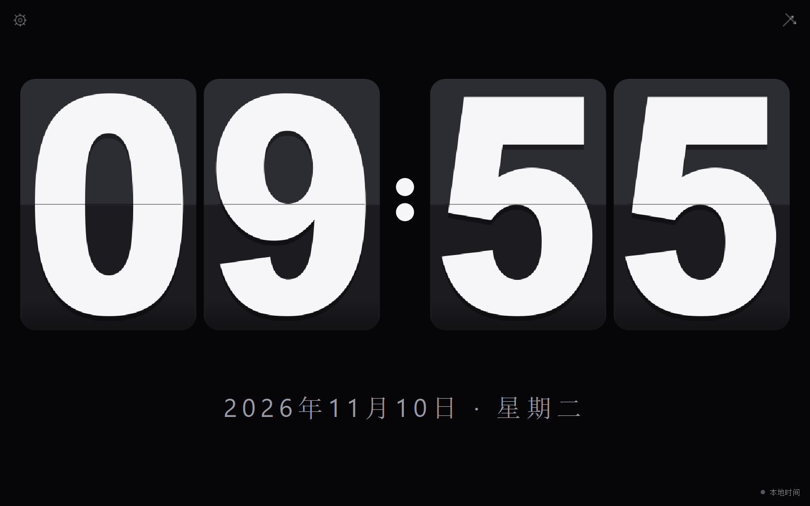
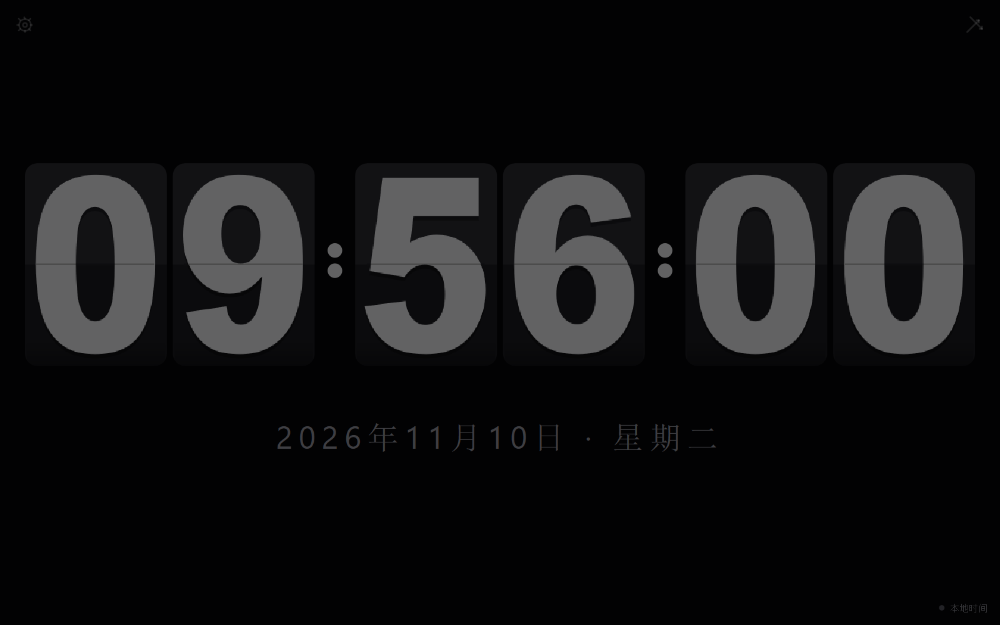
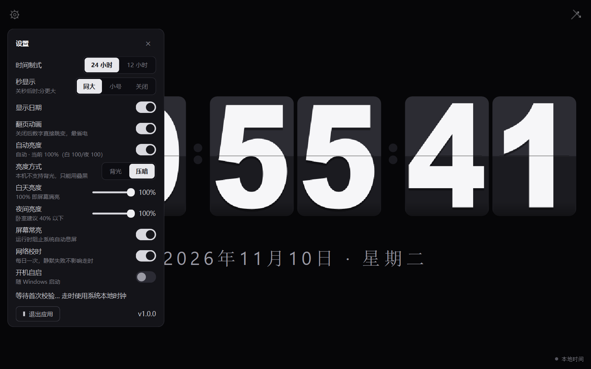

# 翻页时钟 FlipClock

> A minimal, single-process split-flap clock for Windows. Runs 24/7 on a low-end touch tablet.
> 给低配 Windows 触屏平板用的全屏翻页时钟——单进程自绘、静止零 CPU、按时间自动调背光。


| 关秒（数字更大） | 夜间自动压暗 | 设置面板 |
|---|---|---|
|  |  |  |

---

## 它做什么

只显示时间。没有账号、没有联网依赖、没有多余功能。

- **翻页钟渲染**：上下半卡明暗渐变 + 中线翻页轴 + 350ms 翻页动画，还原 split-flap 质感
- **秒显示三档**：同大 / 秒小一号（时:分自动变大）/ 关闭（数字高 343px）
- **自动亮度**：按时间在白天/夜间两档间平滑过渡，**默认真调屏幕背光**（Power API，与 Windows 亮度条同源）；设备不支持时自动退回画面叠黑
- **屏幕常亮**：`SetThreadExecutionState`，挂机不休眠
- **网络校时（可关）**：每日一次 NTP 偏差体检，失败静默、绝不改系统时间
- **三通道退出全屏**：右上 ✕（44px 触屏热区）/ 双击 / Esc
- **配置自愈**：原子写 + `.bak` 轮换 + 损坏自动恢复

**资源目标（本机实测）**：单进程内存 70–90MB、静止 CPU 0%、无 GPU 进程、运行期零磁盘写入。
没有选 Electron：同场景 Electron 进程树 302MB vs PySide6 单进程 57MB（数据与理由见 [`技术方案.md`](技术方案.md) §2.1）。

---

## 环境要求

- Windows 10/11（背光调节依赖 Windows Power API；其它功能与平台无关的部分也可移植）
- Python 3.10+ 与 PySide6（`pip install PySide6`），无其它第三方运行时依赖
- 打包需要 PyInstaller（`pip install pyinstaller`）；生成图标需要 Pillow（可选）

## 快速开始

```bash
# 1) 装依赖
pip install PySide6

# 2) 全屏运行（目标设备上的正式形态）
python src/main.py

# 3) 本机看效果：窗口化 + 不抢前台焦点 + 不盖住你正在干活的窗口 + 不拦息屏
python src/main.py --bg          # Windows 上也可双击 后台看效果.bat
```

设置：启动后点左上角**齿轮**，11 项配置即时生效并写盘（配置落在 `%APPDATA%\FlipClock\config.json`）。
退出：右上 ✕ / 双击画面 / Esc。

## 打包与安装

```bash
python build_app.py                 # onedir 打包 + 可审计瘦身清单，约 40 秒
python _probe/packaged_smoke.py     # 打包态冒烟（删错 Qt 组件会在这里暴露）
```

产物 `dist/FlipClock/`（49 个文件，**64.0 MB**），整目录拷贝到目标机器双击 `FlipClock.exe` 即可。
只做 **onedir**、不做单文件版：常驻型应用，单文件每次启动都要把运行时解压到 `%TEMP%`，纯代价。

装到常驻设备：面板里打开「开机自启」（写 `HKCU\...\Run`，无需管理员），并把系统电源计划的「关闭屏幕」设为「从不」。

---

## 项目结构

```
src/
├── main.py           入口：单实例锁+激活、窗口启动策略（全屏 / --bg 后台）
├── clock_widget.py   翻页钟主控件：全屏自绘、字形位图缓存、局部重绘、翻页动画、亮度落地
├── settings_panel.py 设置面板浮层（自绘 iOS 风格开关）
├── brightness.py     自动亮度曲线（纯函数：两档 + 两段 smoothstep 过渡，可单测）
├── screen_bright.py  屏幕背光：ctypes 直调 powrprof Power API（零依赖，退出还原）
├── settings.py       配置：原子写 + .bak 轮换 + 损坏自愈
├── time_source.py    时间格式化与秒对齐调度
├── ntp_check.py      网络校时：daemon 线程 + stdlib socket（NTP → HTTP Date 兜底）
├── debounce.py       写盘防抖（拖滑杆不产生写放大）
└── keep_awake.py     屏幕常亮：SetThreadExecutionState
_probe/               12 个回归脚本（188 项断言，不进发布包）
docs/screenshots/     README 用截图
技术方案.md           设计 / 选型 / 实测数据 / 验收标准
经验总结.md           踩坑与验证方法论（PySide6 自绘、打包、性能测量）
```

## 验证

```bash
python _probe/test_logic.py      # 逻辑与配置（51 项）
python _probe/geom_check.py      # 几何：居中 / 尺寸推导 / 三档布局 / 字形不裁不偏（27 项）
python _probe/toggle_check.py    # 设置切换的脏区覆盖（白盒，不开窗不打扰桌面，12 项）
python _probe/defects_check.py   # 焦点 / 防抖 / 线程 / 资源路径 / 窗口几何（15 项）
python _probe/panel_fit.py       # 定宽面板文字裁切与挤压（14 项）
python _probe/smoke.py           # 9 场景截图冒烟 + 像素断言（32 项）
python _probe/bright_cost.py     # 自动亮度资源代价：单位成本 × 发生次数（6 项）
python _probe/backlight_check.py # 真背光读写 / 切换 / 还原（24 项，会短暂改动本机亮度）
python _probe/bg_mode_check.py   # 后台模式不抢焦点（7 项）
python _probe/mem_check.py       # 90 秒内存老化（红线 ≤100MB）
```

`smoke.py` 会把截图落在 `_probe/shots/`——**截图必须人工过目**，逻辑断言测不出渲染类问题。

<details>
<summary>AUTOTEST 环境变量（自动化验证用）</summary>

| 变量 | 作用 |
|---|---|
| `FLIPCLOCK_AUTOTEST=1` | 窗口 1280×800 不全屏、不抢常亮、不起 NTP、配置写入临时目录 |
| `FLIPCLOCK_SCREENSHOT=path` | 启动数秒后截图并退出 |
| `FLIPCLOCK_PANEL=1` / `FLIPCLOCK_TOAST=1` | 启动即打开面板 / 显示手势提示 |
| `FLIPCLOCK_FREEZE_ANIM=0.5` | 把翻页动画钉在指定进度 |
| `FLIPCLOCK_CFG='{"fmt24":false}'` | 覆盖配置项 |
| `FLIPCLOCK_FAKE_HOUR=20` | 伪造当前小时（验证自动亮度的白天/黄昏/夜间） |
| `FLIPCLOCK_ALLOW_BRIGHT=1` | AUTOTEST 下也允许真写系统背光（默认禁止，免得测试动了开发机） |
| `FLIPCLOCK_DURATION=sec` | 到时自动退出 |
</details>

## 已知限制

- 背光调节走 Windows Power API（`PowerWriteACValueIndex`），**改的是当前电源计划的亮度值**：程序退出时会还原启动时读到的原值，中途强杀（任务管理器结束进程）则不会还原。
- 渲染管线是 Windows 桌面 Qt 光栅自绘；未在其它平台验证过背光与常亮两项（其余功能可移植）。
- 仅在 1280×800 / 125% 缩放的真实低配平板上做过完整验收；对角线更长的 4:3 屏建议先看 `--bg` 效果。

## License

[MIT](LICENSE)
